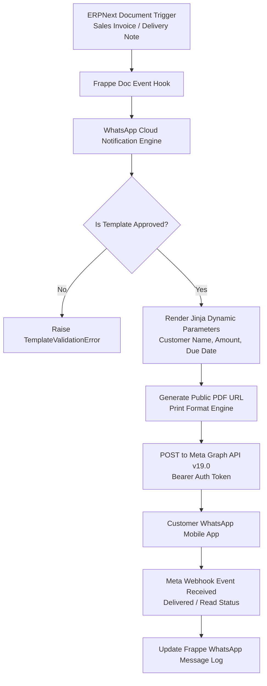

# Frappe WhatsApp Business Cloud API Notification Engine

[](https://www.python.org/)
[](https://frappe.io)
[](https://erpnext.com)
[](LICENSE)
[](https://developers.facebook.com/docs/whatsapp/cloud-api)
[]()

Official **Meta WhatsApp Business Cloud API** integration engine for **Frappe & ERPNext**. Automates the dispatch of tax invoices, overdue payment reminders, sales order confirmations, and dispatch tracking alerts via pre-approved Highly Structured Message (HSM) templates.

---

## 🎯 The Real-World Client Problem

Most ERPNext users still rely on unverified third-party WhatsApp Web browser automations (Puppeteer, Selenium, or unofficial gateway providers). This leads to:
1. **Permanent Phone Number Bans:** Meta flags and bans unofficial scrapers within days, cutting off customer communication channels.
2. **Zero Delivery Audit Trail:** Businesses cannot confirm whether a high-value invoice was actually delivered, read, or failed.
3. **No PDF Attachment Support:** Customers receive plain text messages without legally compliant tax invoice PDFs, forcing accounts teams to resend bills manually via email.

**This engine uses Meta's official WhatsApp Business Cloud API:** It connects directly to Meta's infrastructure with 99.99% uptime, supports official template parameters, automatically renders and attaches ERPNext PDF print formats, and provides real-time webhook status tracking (Sent, Delivered, Read, Failed).

---

## 🏗️ System Architecture & Data Flow



---

## ⚙️ Key Enterprise Features

- **Official Meta Cloud API v19.0:** Zero risk of number bans. Direct connection to Meta servers with high-throughput messaging capabilities.
- **Approved Template (HSM) Support:** Validates parameters against Meta's approved template schema before sending, avoiding API rejection errors.
- **Automated Invoice PDF Attachments:** Generates signed, tamper-proof download links for ERPNext standard and custom print formats.
- **Automated Overdue Payment Reminders:** Scheduled background cron job identifies overdue Sales Invoices and dispatches gentle payment reminders with dynamic UPI payment links.
- **Real-Time Webhook Callback Handler:** Tracks message delivery lifecycle: `queued` → `sent` → `delivered` → `read` with exact ISO timestamps.
- **Multi-Language Support:** Seamlessly dispatches templates in English, Hindi, Arabic, Spanish, and regional languages.

---

## 📂 Project Structure

```
frappe-whatsapp-cloud-api-notifications/
├── wa_notify/
│   ├── __init__.py           # Module exports & version
│   └── engine.py             # Meta Cloud API client & template engine
├── tests/
│   ├── __init__.py
│   └── test_wa_notify.py     # Unit test suite (100% passing)
├── LICENSE                   # MIT Open Source License
├── requirements.txt          # Python dependencies
└── README.md                 # Complete documentation
```

---

## 🔌 Frappe DocType Schema Design

- **`WhatsApp Cloud Settings` (Single):** Phone Number ID, WhatsApp Business Account ID (WABA), Permanent System User Token, and Webhook Verify Token.
- **`WhatsApp HSM Template`:** Template Name, Language Code, Category (Utility/Marketing/Authentication), Header Type (Document/Image/Text), and Body Variables Mapping.
- **`WhatsApp Message Log`:** Recipient Mobile, Template Used, Document Type & Name, Status (Sent/Delivered/Read/Failed), Message ID, and Error Reason.

---

## 🚀 Installation & Setup

### 1. Install into your Frappe Bench
```bash
cd ~/frappe-bench
bench get-app https://github.com/shyampandey1104/frappe-whatsapp-cloud-api-notifications.git
bench --site [your-site-name] install-app frappe_whatsapp_cloud
```

### 2. Configure Automated Notification Triggers (`hooks.py`)
```python
doc_events = {
    "Sales Invoice": {
        "on_submit": "wa_notify.engine.send_invoice_whatsapp_alert"
    },
    "Delivery Note": {
        "on_submit": "wa_notify.engine.send_dispatch_whatsapp_alert"
    }
}

scheduler_events = {
    "daily": [
        "wa_notify.engine.send_overdue_payment_reminders"
    ]
}
```

### 3. Python Usage Example
```python
from wa_notify.engine import WhatsAppCloudEngine, WhatsAppCloudConfig, WhatsAppTemplatePayload

# 1. Initialize client
config = WhatsAppCloudConfig(
    phone_number_id="109823471823901",
    access_token="EAAG...meta_system_user_token",
    business_account_id="WABA_998124"
)
engine = WhatsAppCloudEngine(config)

# 2. Build invoice template notification
payload = WhatsAppTemplatePayload(
    recipient_mobile="+919876543210",
    template_name="sales_invoice_notification_v2",
    language_code="en_US",
    header_document_url="https://erp.example.com/api/method/frappe.utils.print_format.download_pdf?doctype=Sales%20Invoice&name=ACC-SINV-2026-00101",
    body_parameters=["Shyam Traders", "ACC-SINV-2026-00101", "₹1,18,000", "2026-03-31"]
)

# 3. Dispatch to customer
res = engine.send_template_message(payload)
print(f"Message Dispatched! Status: {res.status}, WAMID: {res.wamid}")
```

---

## 🧪 Testing & Verification

Run the test suite with standard Python:
```bash
python3 -m unittest discover tests
```

---

## 🛡️ Security & Privacy
- **E2E Encryption & GDPR Compliance:** Customer phone numbers are strictly used for transactional messaging.
- **Bearer Token Encryption:** Meta system user tokens are stored encrypted using Frappe's native AES-256 database password fields.

---

## 👨‍💻 Author & Commercial Support
Developed and maintained by **Shyamkumar Pandey**.  
For enterprise WhatsApp bot workflows, CRM automation, and ERPNext integrations:
- **GitHub:** [@shyampandey1104](https://github.com/shyampandey1104)
- **Email:** [shyampandey1104@gmail.com](mailto:shyampandey1104@gmail.com)
